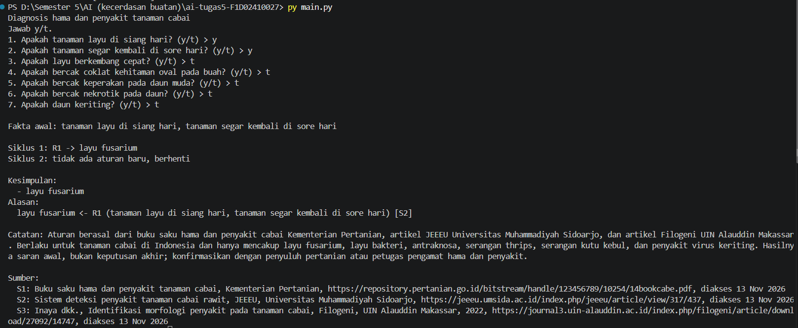
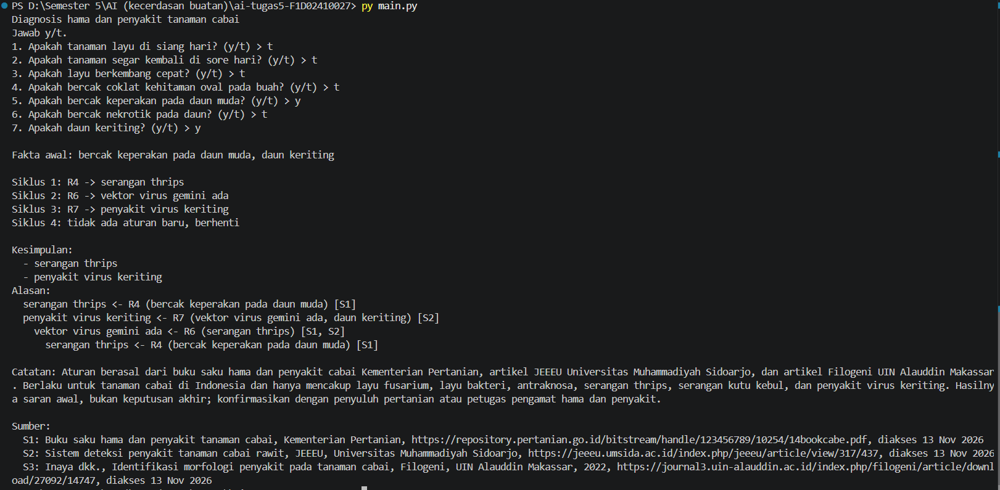
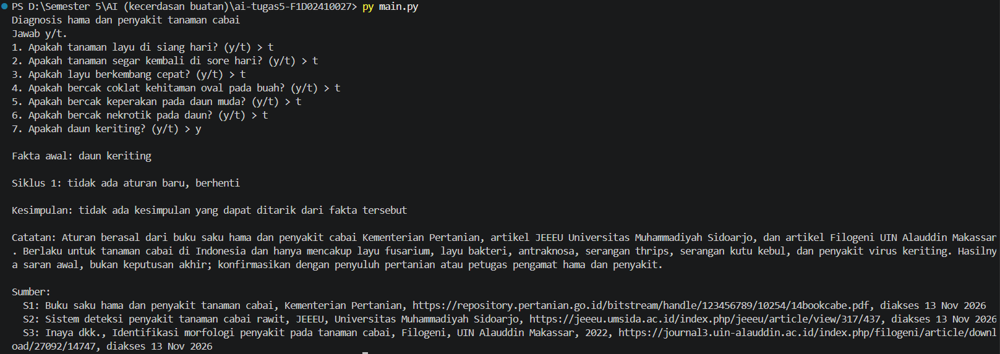

# Sistem Pakar Diagnosis Hama dan Penyakit Cabai (Forward Chaining)

## 1. Nama dan NIM

- **Nama:** Winona Andien Jihan Habbibah
- **NIM:** F1D02410027
- **Mata kuliah:** Kecerdasan Buatan, Tugas 5

## 2. Topik dan cara menjalankan program

**Topik:** diagnosis hama dan penyakit tanaman cabai. Petani bisa mengamati gejala di lapangan (layu, bercak, daun keriting), tetapi gejala yang mirip bisa berasal dari penyebab berbeda. Program ini mengubah gejala yang diamati menjadi kesimpulan: layu fusarium, layu bakteri, antraknosa, serangan thrips, serangan kutu kebul, atau penyakit virus keriting.

**Bahasa dan versi:** Python 3.14.4. Tanpa library tambahan (hanya `json` dan `sys` bawaan Python).

**Perintah** (jalankan dari folder tempat `main.py` dan `kb_cabai.json` berada):

```bash
python main.py          # mode interaktif, jawab y atau t
python main.py --ya "bercak keperakan pada daun muda,daun keriting"   # mode cepat
python uji.py           # menjalankan semua kasus uji otomatis
```

| File | Fungsi |
| :-- | :-- |
| `kb_cabai.json` | Basis pengetahuan: aturan, sumber, daftar kesimpulan, batas keberlakuan |
| `main.py` | Mesin forward chaining, penelusuran alasan, dan tampilan hasil |
| `uji.py` | Uji otomatis lima kasus uji |
| `screenshot/` | Tangkapan layar hasil program |

## 3. Daftar sumber dan tabel aturan

### Daftar sumber

| Kode | Judul | Penerbit | URL | Tanggal akses |
| :-- | :-- | :-- | :-- | :-- |
| S1 | [ISI JUDUL LENGKAP] Buku saku hama dan penyakit tanaman cabai | Kementerian Pertanian | https://repository.pertanian.go.id/bitstream/handle/123456789/10254/14bookcabe.pdf | [ISI TANGGAL] |
| S2 | [ISI JUDUL LENGKAP] Sistem deteksi penyakit tanaman cabai rawit | JEEEU, Universitas Muhammadiyah Sidoarjo | https://jeeeu.umsida.ac.id/index.php/jeeeu/article/view/317/437 | [ISI TANGGAL] |
| S3 | [ISI JUDUL LENGKAP] Identifikasi morfologi penyakit pada tanaman cabai (Inaya dkk., 2022) | Filogeni, UIN Alauddin Makassar | https://journal3.uin-alauddin.ac.id/index.php/filogeni/article/download/27092/14747 | [ISI TANGGAL] |

Yang diambil dari tiap sumber:

- **S1:** gejala serangan thrips (bercak keperakan pada daun muda), gejala kutu kebul (bercak nekrotik pada daun) dan perannya sebagai pembawa virus.
- **S2:** gejala layu fusarium (layu siang hari dan segar kembali sore hari), layu bakteri (mirip tetapi lebih cepat), antraknosa (bercak coklat kehitaman oval pada buah), serta daun keriting yang berkaitan dengan virus gemini yang dibawa thrips, kutu kebul, dan aphids.
- **S3:** gejala antraknosa pada buah dan serangan thrips berdasarkan pengamatan di lapangan.

### Tabel aturan

| Aturan | IF | THEN | Sumber |
| :-- | :-- | :-- | :-- |
| R1 | tanaman layu di siang hari **AND** tanaman segar kembali di sore hari | layu fusarium | S2 |
| R2 | tanaman layu di siang hari **AND** layu berkembang cepat | layu bakteri | S2 |
| R3 | bercak coklat kehitaman oval pada buah | antraknosa | S2, S3 |
| R4 | bercak keperakan pada daun muda | serangan thrips | S1 |
| R5 | bercak nekrotik pada daun | serangan kutu kebul | S1 |
| R6 | serangan thrips **OR** serangan kutu kebul | vektor virus gemini ada | S1, S2 |
| R7 | vektor virus gemini ada **AND** daun keriting | penyakit virus keriting | S2 |

Fakta dasar (ditanyakan ke pengguna) adalah gejala yang tidak pernah menjadi hasil aturan, misalnya "daun keriting". Fakta turunan adalah hasil aturan, misalnya "serangan thrips". Ada tujuh aturan dan enam kesimpulan akhir: layu fusarium, layu bakteri, antraknosa, serangan thrips, serangan kutu kebul, dan penyakit virus keriting.

Rantai aturan: R4 menghasilkan "serangan thrips", dipakai R6 untuk menghasilkan "vektor virus gemini ada", yang dipakai R7 untuk menghasilkan "penyakit virus keriting". Daun keriting saja tidak langsung dianggap virus, karena S2 menyebut penyebabnya bisa juga kekurangan nitrogen. Karena itu R7 mensyaratkan adanya vektor.

## 4. Metode yang dipilih: Forward Chaining

**Alasan memilih:** petani sudah memiliki fakta berupa gejala yang diamati dan ingin tahu penyebabnya, jadi penalaran berjalan dari fakta ke kesimpulan, sesuai dengan forward chaining.

**Cara kerja:** mulai dari fakta yang diketahui, jalankan aturan yang cocok, tambahkan hasilnya ke memori, ulangi sampai tidak ada aturan baru. Aturan yang hasilnya sudah ada tidak dijalankan lagi, kalau tidak program tidak pernah berhenti.

```
memori ← fakta yang dijawab "ya" oleh user
ULANGI:
    cocok ← aturan yang syaratnya terpenuhi oleh memori DAN hasilnya belum ada di memori
    JIKA cocok kosong:
        BERHENTI
    r ← cocok[0]                          # ambil aturan pertama
    tambahkan r.maka ke memori
    catat bahwa r.maka berasal dari r     # bahan "alasan"

  # syarat terpenuhi: mode "dan" = semua ada di memori, mode "atau" = salah satu ada
```

Pseudocode ini diimplementasikan di fungsi `forward_chaining()` pada `main.py`. Catatan asal aturan dipakai fungsi `alasan()` untuk menelusuri kesimpulan mundur sampai ke fakta yang dijawab pengguna.

**Contoh hitungan tangan** (jawaban "ya": bercak keperakan pada daun muda dan daun keriting):

| Siklus | Aturan yang cocok | Dijalankan | Fakta baru di memori |
| :-- | :-- | :-- | :-- |
| 1 | R4 | R4 | serangan thrips |
| 2 | R6 | R6 | vektor virus gemini ada |
| 3 | R7 | R7 | penyakit virus keriting |
| 4 | tidak ada | berhenti | - |

Pada siklus 1 hanya R4 yang cocok. Pada siklus 2, R6 cocok karena modenya "atau" dan "serangan thrips" sudah ada di memori. Pada siklus 3, R7 cocok karena "vektor virus gemini ada" dan "daun keriting" sama-sama ada. Pada siklus 4 semua hasil aturan sudah ada di memori, sehingga tidak ada aturan baru dan program berhenti.

## 5. Tiga kasus uji dan screenshot

| # | Jawaban "ya" | Kesimpulan |
| :-- | :-- | :-- |
| 1 | tanaman layu di siang hari, tanaman segar kembali di sore hari | layu fusarium |
| 2 | bercak keperakan pada daun muda, daun keriting | serangan thrips, penyakit virus keriting |
| 3 (negatif) | daun keriting saja | tidak ada kesimpulan |

Pada kasus 3, tidak ada hama pembawa virus yang terdeteksi, sehingga R7 tidak terpenuhi dan program menampilkan bahwa tidak ada kesimpulan. Dua kasus tambahan (layu bakteri dan antraknosa) ada di `uji.py`, yang dijalankan dengan `python uji.py`.

**Kasus 1** (menghasilkan kesimpulan)

```
Fakta awal: tanaman layu di siang hari, tanaman segar kembali di sore hari

Siklus 1: R1 -> layu fusarium
Siklus 2: tidak ada aturan baru, berhenti

Kesimpulan:
  - layu fusarium
Alasan:
  layu fusarium <- R1 (tanaman layu di siang hari, tanaman segar kembali di sore hari) [S2]
```



**Kasus 2** (menghasilkan kesimpulan)

```
Fakta awal: bercak keperakan pada daun muda, daun keriting

Siklus 1: R4 -> serangan thrips
Siklus 2: R6 -> vektor virus gemini ada
Siklus 3: R7 -> penyakit virus keriting
Siklus 4: tidak ada aturan baru, berhenti

Kesimpulan:
  - serangan thrips
  - penyakit virus keriting
Alasan:
  serangan thrips <- R4 (bercak keperakan pada daun muda) [S1]
  penyakit virus keriting <- R7 (vektor virus gemini ada, daun keriting) [S2]
    vektor virus gemini ada <- R6 (serangan thrips) [S1, S2]
      serangan thrips <- R4 (bercak keperakan pada daun muda) [S1]
```



**Kasus 3** (tanpa kesimpulan)

```
Fakta awal: daun keriting

Siklus 1: tidak ada aturan baru, berhenti

Kesimpulan: tidak ada kesimpulan yang dapat ditarik dari fakta tersebut
```



## 6. Batas keberlakuan

Pengetahuan dalam program ini berasal dari buku saku Kementerian Pertanian dan dua artikel jurnal universitas tentang hama dan penyakit cabai di Indonesia. Aturan hanya berlaku untuk tanaman cabai dan hanya mencakup layu fusarium, layu bakteri, antraknosa, serangan thrips, serangan kutu kebul, dan penyakit virus keriting, tanpa membahas hama atau penyakit lain, tahap pertumbuhan, varietas, atau kondisi cuaca. Gejala yang mirip bisa berasal dari penyebab lain, misalnya kekurangan unsur hara. Hasilnya berupa saran awal, bukan keputusan akhir: petani sebaiknya mengonfirmasi dengan penyuluh pertanian atau petugas pengamat hama dan penyakit sebelum mengambil tindakan. 

## 7. Penggunaan alat bantu AI

Saya menggunakan Claude (Anthropic) untuk membantu mencari kandidat sumber, menyusun draf aturan IF-THEN. Sumber saya buka dan periksa sendiri, aturan saya sesuaikan dengan isi sumber, dan saya memahami serta dapat menjelaskan aturan dan kode.